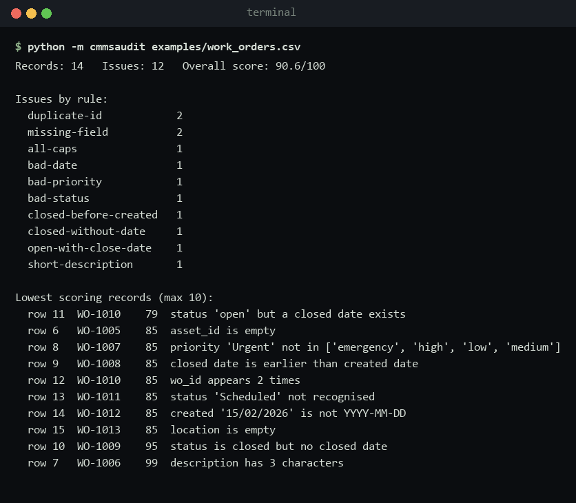

# cmms-data-quality-auditor

[](https://github.com/yassine2med/cmms-data-quality-auditor/actions/workflows/ci.yml)  

Scores a work-order CSV from a CMMS for data quality, with a count per rule and a list of the worst records.



## What it is for

Work-order exports from a CMMS (the system a facility team uses to track maintenance requests) often carry blank fields, invented statuses, dates in mixed formats, closed tickets with no close date and repeated IDs. Reports built on that data are wrong before anyone reads them. A facility coordinator, maintenance planner or data analyst runs this tool on an export before building a report or moving data to a new system. They get a score from 0 to 100 for the file and the exact rows to fix.

## Install

```
cd cmms-data-quality-auditor
python -m pip install -e .
python -m pip install pytest
```

Python 3.10 or newer. No other dependency.

## How to use

| I want to | Command |
| --- | --- |
| Score a work-order file | `python -m cmmsaudit examples/work_orders.csv` |
| List more or fewer of the lowest scoring records (default 10) | `python -m cmmsaudit FILE --limit 20` |
| Exit with code 1 when the file score is too low, for a scheduled job | `python -m cmmsaudit FILE --min-score 85` |
| See all options | `python -m cmmsaudit --help` |

Exit code 0 means the score met `--min-score` (default 0), 1 means it was below, 2 means the file could not be read. Row numbers are CSV line numbers, with the header as line 1. The sample data is invented.

Worked example:

```
python -m cmmsaudit examples/work_orders.csv
```

Output:

```
Records: 14   Issues: 12   Overall score: 90.6/100

Issues by rule:
  duplicate-id            2
  missing-field           2
  all-caps                1
  bad-date                1
  bad-priority            1
  bad-status              1
  closed-before-created   1
  closed-without-date     1
  open-with-close-date    1
  short-description       1

Lowest scoring records (max 10):
  row 11  WO-1010    79  status 'open' but a closed date exists
  row 6   WO-1005    85  asset_id is empty
  row 8   WO-1007    85  priority 'Urgent' not in ['emergency', 'high', 'low', 'medium']
  row 9   WO-1008    85  closed date is earlier than created date
  row 12  WO-1010    85  wo_id appears 2 times
  row 13  WO-1011    85  status 'Scheduled' not recognised
  row 14  WO-1012    85  created '15/02/2026' is not YYYY-MM-DD
  row 15  WO-1013    85  location is empty
  row 10  WO-1009    95  status is closed but no closed date
  row 7   WO-1006    99  description has 3 characters
```

## How it works

- Each record starts at 100 points.
- Every rule violation has a severity: error costs 15, warning costs 5, info costs 1. The record score is 100 minus the total, with a floor of 0.
- The file score is the mean of the record scores.
- Per-record rules: required fields present, priority in the allowed list, status in the allowed list, dates in YYYY-MM-DD, close date not before create date, closed status has a close date, open status has no close date, description at least 12 characters, description not all capitals.
- File rule: a `wo_id` that appears more than once is an error on every row that uses it.
- Allowed priorities and statuses are constants at the top of `src/cmmsaudit/audit.py`.

## Limits

- Expects the column names `wo_id, asset_id, location, description, priority, status, created, closed`. There is no column mapping option.
- Reads CSV only, and dates only in YYYY-MM-DD.
- Scores are a simple weighted count, not a statistical measure. It does not check that an asset ID exists in an asset list.

## License

MIT. Copyright 2026 Yassine Emhamed.
